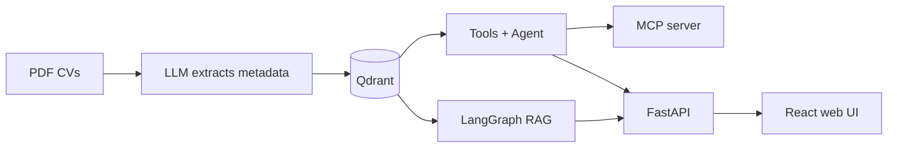
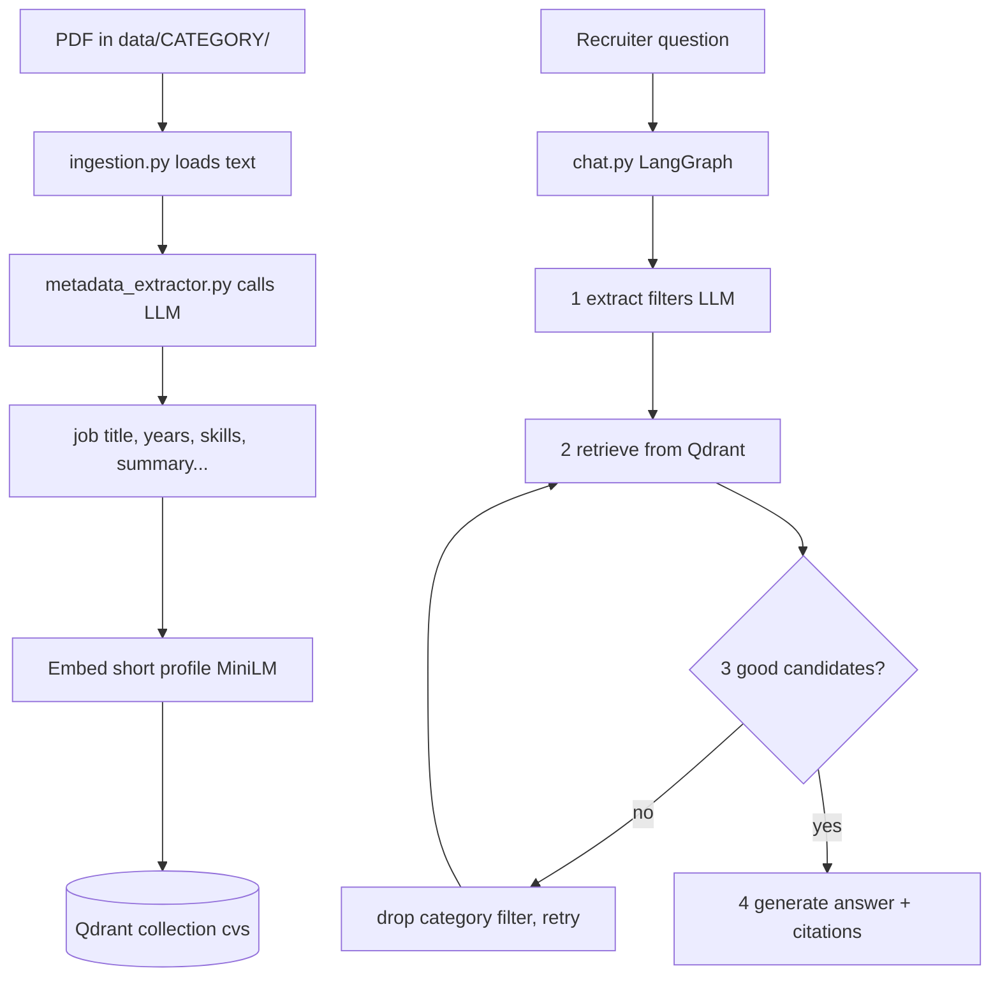
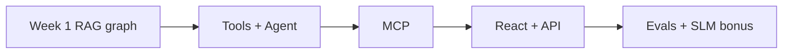

# Teacher briefing — CV Screening Assistant

**Repo:** https://github.com/Nemri-Yassine/cv-screening-project  
**Team:** Yassine Nemri · Ihab Lamouchi  
**One sentence:** A recruiter asks in natural language; we search a PDF CV database with RAG + LangGraph, cite the CVs, and show answers in a React app (plus tool calling / MCP).

Use this page to talk. Open the files in Cursor when the teacher asks “where is the code?”.

---

## Big picture (draw this on the board)



**Teacher mapping (mandatory features):**

| They ask for | We say | File |
|---|---|---|
| RAG + metadata + citations | Yes | `ingestion.py`, `metadata_extractor.py`, `chat.py` |
| LangChain / LangGraph | Yes | `chat.py`, `agent.py` |
| Tool calling / MCP | Yes | `tools.py`, `agent.py`, `mcp_server.py` |
| Benchmarking | Yes | `eval_retrieval.py`, `eval_generation.py` |
| Web interface | Yes | `api.py` + `frontend/` |
| Fine-tuning (optional) | Bonus done | `finetune_slm.ipynb` |

---

## Week 1 = the foundation (explain THIS first)

Week 1 is **not** the fancy agent yet. It is: **ingest CVs → store in Qdrant → ask questions with a fixed RAG graph**.



### Script you can say out loud

1. **Ingestion:** each CV PDF is read; an LLM extracts structured metadata (title, years, skills…).
2. We do **not** embed the whole messy PDF. We embed a short profile string (title + summary + skills) → better search.
3. Everything goes into **Qdrant** with metadata filters (category, years).
4. At question time, **LangGraph** runs fixed steps: extract filters → search → grade → maybe retry without category → answer with `[filename.pdf]` citations.

### Where the LLM is called (Week 1)

| Step | What the LLM does | File | Lines |
|---|---|---|---|
| Create Groq client | model `openai/gpt-oss-120b` | `metadata_extractor.py` | 18–22 |
| Extract CV fields | structured output `CVMetadata` | `metadata_extractor.py` | 35–40 |
| Call extraction from ingest | `extract_metadata(text)` | `ingestion.py` | 69 |
| Create Groq client (chat) | model `openai/gpt-oss-20b` | `chat.py` | 50–53 |
| Extract search filters | `filter_chain.invoke(...)` | `chat.py` | 96, 147 |
| Grade retrieved CVs | `grade_chain.invoke(...)` | `chat.py` | 97, 182–186 |
| Write the final answer | `answer_chain.invoke(...)` | `chat.py` | 98, 168–173 |
| Vector search (no LLM) | `similarity_search` | `chat.py` | 152–157 |
| Graph wiring | `StateGraph` nodes/edges | `chat.py` | 191–204 |

**Tip:** open `chat.py` around line 191 — the graph is the whole Week‑1 story in one place.

### Metadata fields (say this if asked “what metadata?”)

From `metadata_extractor.py` (`CVMetadata`): `job_title`, `years_experience`, `education_level`, `skills`, `summary`  
Plus folder name = `category`, and `file_name` for citations.

---

## After Week 1 (short — only if they ask)



| Layer | One line | Open this |
|---|---|---|
| Tools | search / read CV / compare / list categories | `tools.py` (~92–138 `@tool`) |
| Agent | LLM chooses tools (`bind_tools`) | `agent.py` 39–48, 52–60 |
| MCP | same tools for Claude/Cursor | `mcp_server.py` |
| API | `/api/chat` agent or rag mode | `api.py` 66–87 |
| UI | chat + sources + PDF panel | `frontend/src/App.tsx` |
| Retrieval eval | Precision@k, MRR | `eval_retrieval.py` |
| Generation eval | LLM-as-judge | `eval_generation.py` |
| SLM bonus | LoRA on Qwen 0.5B | `finetune_slm.ipynb` |

### Agent LLM call (if they ask tool calling)

- Create LLM: `agent.py` **39–43**
- Bind tools: `agent.py` **44**
- Call LLM: `agent.py` **48** (`llm_with_tools.invoke`)
- Loop tools ↔ agent: `agent.py` **52–60**

---

## Progress status (honest)

| Done in code | Still to finish for the course |
|---|---|
| RAG, metadata, citations | Full run on your PC: Docker/Qdrant + `.env` + `data/` PDFs |
| LangGraph RAG + agent + MCP | Live demo with real Groq answers |
| FastAPI + React UI | Technical report PDF + presentation slides |
| Eval scripts + SLM notebook | Daily commits continuing (see `PHASES.md`) |
| GitHub repo with history | — |

**Current week story for the teacher:**  
“We built and published the core RAG pipeline (ingest → Qdrant → LangGraph chat). We added a setup checker after verifying the machine. Next we test the tool-calling agent with real API calls and polish the UI.”

---

## 30-second demo path (when stack is up)

```bash
docker compose up -d
python scripts/check_setup.py
python ingestion.py
uvicorn api:app --reload --port 8000
# other terminal:
cd frontend && npm run dev
```

Ask in the UI: *“Find IT profiles with Python and at least 3 years of experience”*  
→ answer should cite `[something.pdf]` and show source cards.
